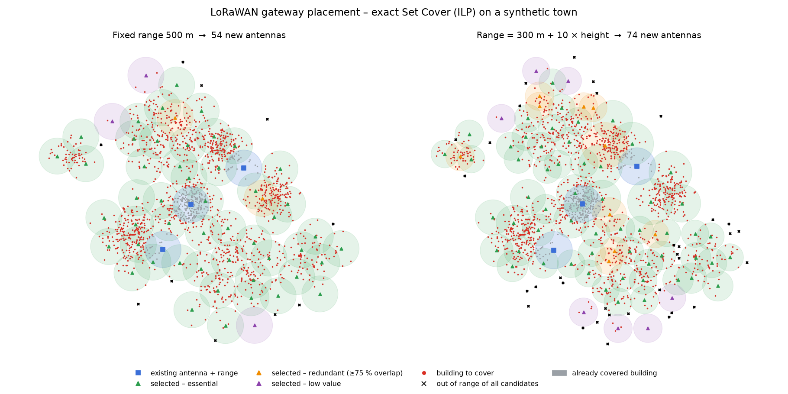
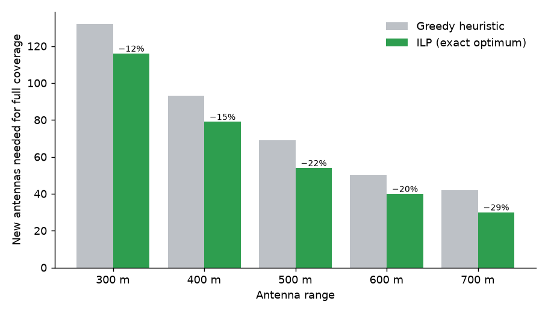

# LoRaWAN Gateway Placement – Set Cover Optimisation (QGIS + GeoPandas)

🇬🇧 **English** · 🇵🇱 [Wersja polska](README.pl.md)

[](https://github.com/MalickiJacek/lorawan-set-cover/actions/workflows/tests.yml)


**Where should we mount LoRaWAN gateways so that every building is in range – using as few antennas as possible?**

This repository solves that question as an exact **Integer Linear Program (Set Cover / Maximum Coverage)** on top of a classic GIS workflow (centroids → buffers → spatial join). It ships in two flavours:

| | `qgis/lorawan_set_cover_qgis.py` | `src/lorawan_setcover/` |
|---|---|---|
| Runs in | QGIS Python console (GUI dialog) | any Python, headless CLI |
| GIS engine | QGIS Processing (`native:buffer`, `joinattributesbylocation`, …) | GeoPandas / Shapely |
| Output | styled layers in the QGIS project + CSV | GeoPackage + CSV |
| Use case | analysts working in QGIS | automation, CI, batch scenarios |



> All data in this repository is **synthetic** (a fictional town generated by `scripts/generate_synthetic_data.py`). The tool was originally built for a real network-planning task; no production data is published here.

---

## The problem

* Buildings with smart meters need to be within range of a LoRaWAN gateway.
* Some gateways already exist – buildings in their range are excluded.
* New gateways can only be mounted on a set of **candidate buildings** (roof access, height).
* Range is either fixed (e.g. `500` m) or depends on the mounting height (e.g. `400 + 10 × height`).

### Model

Let *x<sub>i</sub>* ∈ {0,1} mean “build an antenna at candidate *i*”, and *S(j)* the set of candidates whose range contains building *j*.

**Mode A – minimum number of antennas, full coverage (Set Cover)**

$$\min \sum_i x_i \quad \text{s.t.} \quad \sum_{i \in S(j)} x_i \ge 1 \;\; \forall j$$

**Mode B – best coverage with a budget of *k* antennas (Maximum Weighted Coverage)**, where *w<sub>j</sub>* = dwellings + commercial units in building *j*:

$$\max \sum_j w_j y_j \quad \text{s.t.} \quad \sum_i x_i \le k, \;\; y_j \le \sum_{i \in S(j)} x_i$$

Both are solved to proven optimality with **PuLP + CBC** (or HiGHS). After solving, the selected antennas are classified as:

* **essential**,
* **redundant** – ≥ 75 % of the range overlaps other selected antennas,
* **low value** – only a few buildings / dwellings in range,

so a planner can discuss trade-offs instead of getting a single black-box answer.

## Why ILP instead of a greedy heuristic?

The greedy algorithm (always pick the antenna covering the most uncovered buildings) is fast but only approximate. On the sample town the exact ILP needs **12–29 % fewer antennas** for the same 100 % coverage – and solves in under a second:



| Range | Greedy | ILP | Saved |
|---:|---:|---:|---:|
| 300 m | 132 | 116 | 12 % |
| 400 m | 93 | 79 | 15 % |
| 500 m | 69 | 54 | 22 % |
| 600 m | 50 | 40 | 20 % |
| 700 m | 42 | 30 | 29 % |

*(1 690 buildings, 576 candidate sites, 3 existing gateways – reproduce with `python scripts/make_figures.py`.)*

---

## Quick start (headless, GeoPandas)

```bash
git clone https://github.com/MalickiJacek/lorawan-set-cover.git
cd lorawan-set-cover
python -m venv .venv && source .venv/bin/activate   # Windows: .venv\Scripts\activate
pip install -e ".[dev]"

python -m lorawan_setcover \
  --buildings  data/sample/Buildings_To_Cover.shp \
  --existing   data/sample/Existing_Antennas.shp \
  --candidates data/sample/Candidate_Antennas.shp \
  --radius 500 --out output
```

```text
Buildings total:            1690
Already covered (existing): 274
To cover:                   1416
Out of range of candidates: 10
Candidate sites:            576
Solver status:              Optimal
Selected antennas:          54 (essential 49, redundant 2, low value 3)
Buildings covered:          1406
Greedy baseline would need: 69 antennas
Runtime:                    0.7 s
```

More options:

```bash
# range depends on mounting height
python -m lorawan_setcover ... --radius "300+10*WYSOKOSC"

# budget of 5 antennas, maximise covered dwellings (LM + LU)
python -m lorawan_setcover ... --budget 5 --weights
```

## Quick start (QGIS)

1. In the **OSGeo4W Shell**: `pip install "pulp>=2.7,<4" pandas`
2. QGIS → *Plugins → Python Console → Show Editor* → open `qgis/lorawan_set_cover_qgis.py` → **Run**.
3. Pick the three shapefiles, the output folder and the parameters in the dialog.

Full step-by-step guide (in Polish): [`docs/INSTRUKCJA_PL.md`](docs/INSTRUKCJA_PL.md).

## Input data

All layers are building footprints (polygons) in a **projected CRS in metres** (e.g. EPSG:2180 / EPSG:2177).

| Layer | Required columns | Notes |
|---|---|---|
| buildings to cover | `ID_SWDE` | `LM`, `LU` (dwellings / commercial units) for weighted mode |
| existing antennas | `ID_SWDE` | `WYSOKOSC` if range is an expression |
| candidate antennas | `ID_SWDE` | `WYSOKOSC` if range is an expression, optional `Adres` |

`ID_SWDE` is the building identifier used in the Polish cadastre (EGiB); any unique ID column can be passed with `--id-col`.

## Outputs

* `lorawan_result.gpkg` – layers: building centroids, buildings to cover, buildings out of range, existing coverage, selected coverage (with `category`)
* `selected_antennas.csv` – ID, category, radius, buildings in range
* `coverage_matrix.csv` – building ↔ antenna pairs fed to the solver

## Project structure

```
├── qgis/lorawan_set_cover_qgis.py      # QGIS console script with configuration dialog
├── src/lorawan_setcover/
│   ├── solver.py                       # ILP models + greedy baseline (no GIS dependency)
│   ├── pipeline.py                     # GeoPandas workflow
│   └── __main__.py                     # CLI
├── scripts/
│   ├── generate_synthetic_data.py      # reproducible fictional town
│   └── make_figures.py                 # README figures + ILP vs greedy benchmark
├── data/sample/                        # synthetic shapefiles
├── tests/                              # pytest (solver + end-to-end pipeline)
└── docs/                               # Polish manual, images
```

## Tests

```bash
pytest
```

The solver tests include a hand-crafted “greedy trap” instance where the greedy heuristic provably picks 3 antennas while the optimum is 2, and a randomised check that the ILP is never worse than greedy. CI runs on every push (GitHub Actions).

## Limitations and ideas

* Range is modelled as a circle – no terrain, building shadowing or radio propagation model. A viewshed on a DSM would be the next step.
* All candidate sites cost the same; per-site costs are a one-line change in the objective.
* Constraints such as “at least one gateway per district” can be added as extra ILP rows (see the Polish manual, *Możliwe modyfikacje*).
* PuLP 4.0 introduced a new API and no longer bundles CBC – the project currently pins `pulp<4`.

## Tech stack

Python · QGIS / PyQGIS (Processing) · GeoPandas · Shapely · PuLP (CBC / HiGHS) · pandas · Matplotlib · pytest · GitHub Actions

## Author

**Jacek Malicki** – GIS developer (geomatics, MSc, Wrocław University of Science and Technology)
[LinkedIn](https://www.linkedin.com/in/jacek-malicki-85b04a27b)

Parts of this public version (headless GeoPandas port, tests, CI) were developed with AI assistance (Claude).

## License

[MIT](LICENSE)
