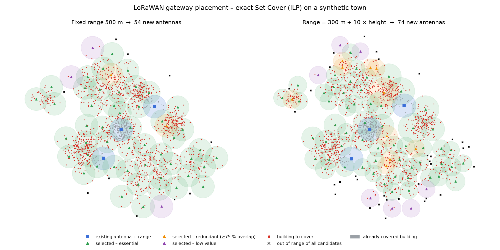
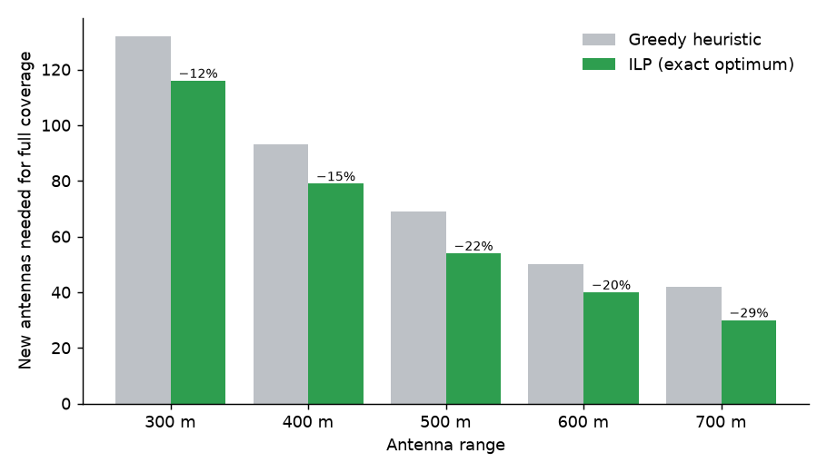

# Rozmieszczenie anten LoRaWAN – optymalizacja Set Cover (QGIS + GeoPandas)

🇬🇧 [English version](README.md) · 🇵🇱 **Polski**

[](https://github.com/MalickiJacek/lorawan-set-cover/actions/workflows/tests.yml)


**Na których budynkach zamontować anteny LoRaWAN, żeby każdy budynek był w zasięgu, a anten było jak najmniej?**

Narzędzie łączy klasyczny workflow GIS (centroidy → bufory zasięgu → złączenie przestrzenne) z **dokładną optymalizacją matematyczną**: programowaniem liniowym całkowitoliczbowym (ILP) dla problemów _Set Cover_ i _Maximum Coverage_. Dostępne są dwie wersje:

|              | `qgis/lorawan_set_cover_qgis.py`                                           | `src/lorawan_setcover/`                       |
| ------------ | -------------------------------------------------------------------------- | --------------------------------------------- |
| Gdzie działa | konsola Pythona w QGIS (okno konfiguracji)                                 | dowolny Python, z linii poleceń               |
| Silnik GIS   | narzędzia Processing QGIS (`native:buffer`, `joinattributesbylocation`, …) | GeoPandas / Shapely                           |
| Wynik        | ostylowane warstwy w projekcie QGIS + CSV                                  | GeoPackage + CSV                              |
| Dla kogo     | analityk pracujący w QGIS                                                  | automatyzacja, testy, wiele scenariuszy naraz |



> Wszystkie dane w repozytorium są **syntetyczne**: to fikcyjne miasteczko wygenerowane skryptem `scripts/generate_synthetic_data.py`. Narzędzie powstało do realnego zadania planistycznego, ale nie publikuję tu żadnych danych produkcyjnych.

---

## Problem

- Budynki z licznikami zdalnego odczytu muszą być w zasięgu anteny LoRaWAN.
- Część anten już istnieje. Budynki w ich zasięgu odpadają z analizy.
- Nowe anteny można zamontować tylko na **budynkach-kandydatach**, czyli tam, gdzie jest dostęp do dachu i odpowiednia wysokość.
- Zasięg jest stały (np. `500` m) albo zależy od wysokości montażu (np. `400 + 10 × wysokość`, czyli wyżej znaczy dalej).

Intuicyjne podejście „bierz antenę, która pokrywa najwięcej budynków, i powtarzaj” (algorytm zachłanny, _greedy_) daje rozwiązanie szybko, ale zwykle **nie najlepsze**. Wczesny wybór „dużej” anteny potrafi wymusić później kilka dodatkowych.

### Model matematyczny

Dla każdego kandydata _i_ jest zmienna _x<sub>i</sub>_ ∈ {0,1}: 1 oznacza „stawiamy tu antenę”. _S(j)_ to zbiór kandydatów, w których zasięgu leży budynek _j_.

**Tryb A: minimalna liczba anten przy pełnym pokryciu (Set Cover)**

$$
\min \sum_i x_i \quad \text{przy} \quad \sum_{i \in S(j)} x_i \ge 1 \;\; \forall j
$$

Po ludzku: minimalizuj liczbę anten tak, żeby każdy budynek miał przynajmniej jedną antenę w zasięgu.

**Tryb B: najlepsze pokrycie przy budżecie _k_ anten (Maximum Weighted Coverage)**, gdzie _w<sub>j</sub>_ to liczba lokali mieszkalnych i użytkowych w budynku _j_:

$$
\max \sum_j w_j y_j \quad \text{przy} \quad \sum_i x_i \le k, \;\; y_j \le \sum_{i \in S(j)} x_i
$$

Po ludzku: mając np. budżet na 5 anten, pokryj jak najwięcej lokali. Zmienna _y<sub>j</sub>_ mówi, czy budynek _j_ jest pokryty. Może wynosić 1 tylko wtedy, gdy wybrano antenę, w której zasięgu leży ten budynek.

Oba modele rozwiązuje biblioteka **PuLP** z solverem **CBC**, z dowodem optymalności. Na koniec wybrane anteny są klasyfikowane jako:

- **niezbędne**,
- **nadmiarowe**: ≥ 75% ich zasięgu pokrywa się z innymi wybranymi antenami (przyjęty % pokrycia przy którym przy testowaniu zasięgu anten sąsiednich antena może okazać się zbędna),
- **mało istotne**: w zasięgu jest tylko kilka budynków lub lokali.

Planista dostaje więc materiał do decyzji, a nie tylko jedną liczbę.

## Dlaczego ILP, a nie algorytm zachłanny?

Na przykładowym miasteczku dokładny ILP potrzebuje **o 12–29% mniej anten** przy tym samym, 100% pokryciu i liczy się w niecałą sekundę:



| Zasięg | Greedy | ILP | Oszczędność |
| -----: | -----: | --: | ----------: |
|  300 m |    132 | 116 |         12% |
|  400 m |     93 |  79 |         15% |
|  500 m |     69 |  54 |         22% |
|  600 m |     50 |  40 |         20% |
|  700 m |     42 |  30 |         29% |

_(1 690 budynków, 576 kandydatów, 3 istniejące anteny; wynik można odtworzyć poleceniem `python scripts/make_figures.py`.)_

---

## Szybki start: wersja bez QGIS (GeoPandas)

```bash
git clone https://github.com/MalickiJacek/lorawan-set-cover.git
cd lorawan-set-cover
python -m venv .venv && source .venv/bin/activate   # Windows: .venv\Scripts\activate
pip install -e ".[dev]"

python -m lorawan_setcover \
  --buildings  data/sample/Buildings_To_Cover.shp \
  --existing   data/sample/Existing_Antennas.shp \
  --candidates data/sample/Candidate_Antennas.shp \
  --radius 500 --out output
```

Przykładowy wynik:

```text
Buildings total:            1690   ← wszystkie budynki
Already covered (existing): 274    ← już w zasięgu istniejących anten
To cover:                   1416   ← do pokrycia
Out of range of candidates: 10     ← poza zasięgiem jakiegokolwiek kandydata
Candidate sites:            576
Solver status:              Optimal
Selected antennas:          54 (essential 49, redundant 2, low value 3)
Buildings covered:          1406
Greedy baseline would need: 69 antennas
```

Inne warianty:

```bash
# zasięg zależny od wysokości budynku
python -m lorawan_setcover ... --radius "300+10*WYSOKOSC"

# budżet 5 anten, maksymalizacja liczby pokrytych lokali (LM + LU)
python -m lorawan_setcover ... --budget 5 --weights
```

## Szybki start: QGIS

1. W **OSGeo4W Shell**: `pip install "pulp>=2.7,<4" pandas`
2. QGIS → _Wtyczki → Konsola Pythona → Pokaż edytor_ → otwórz `qgis/lorawan_set_cover_qgis.py` → **Uruchom**.
3. W oknie dialogowym wskaż trzy pliki shapefile, folder wynikowy i parametry.

Pełna instrukcja krok po kroku, z opisem parametrów i interpretacją wyników: [`docs/INSTRUKCJA_PL.md`](docs/INSTRUKCJA_PL.md).

## Dane wejściowe

Wszystkie warstwy to obrysy budynków (poligony) w **układzie metrycznym**, np. EPSG:2180 lub EPSG:2177.

| Warstwa             | Wymagane kolumny | Uwagi                                                               |
| ------------------- | ---------------- | ------------------------------------------------------------------- |
| budynki do pokrycia | `ID_SWDE`        | `LM`, `LU` (lokale mieszkalne / użytkowe) w trybie ważonym          |
| istniejące anteny   | `ID_SWDE`        | `WYSOKOSC`, gdy zasięg liczony jest wyrażeniem                      |
| anteny potencjalne  | `ID_SWDE`        | `WYSOKOSC`, gdy zasięg liczony jest wyrażeniem; opcjonalnie `Adres` |

`ID_SWDE` to identyfikator budynku z ewidencji gruntów i budynków (EGiB). Można użyć dowolnej unikalnej kolumny, podając ją w parametrze `--id-col`.

## Wyniki

- `lorawan_result.gpkg`: warstwy z centroidami budynków, budynkami do pokrycia, budynkami poza zasięgiem, zasięgiem istniejących anten i zasięgiem wybranych anten (z kolumną `category`)
- `selected_antennas.csv`: identyfikator, kategoria, promień i liczba budynków w zasięgu
- `coverage_matrix.csv`: pary budynek ↔ antena, czyli wejście solvera

## Struktura repozytorium

```
├── qgis/lorawan_set_cover_qgis.py      # skrypt do konsoli QGIS z oknem konfiguracji
├── src/lorawan_setcover/
│   ├── solver.py                       # modele ILP + algorytm zachłanny (bez zależności GIS)
│   ├── pipeline.py                     # workflow w GeoPandas
│   └── __main__.py                     # interfejs wiersza poleceń (CLI)
├── scripts/
│   ├── generate_synthetic_data.py      # generator fikcyjnego miasteczka
│   └── make_figures.py                 # wykresy do README + porównanie ILP vs greedy
├── data/sample/                        # syntetyczne pliki shapefile
├── tests/                              # testy pytest (solver + cały pipeline)
└── docs/                               # instrukcja PL, obrazy
```

## Testy

```bash
pytest
```

Testy solvera zawierają m.in. specjalnie skonstruowaną „pułapkę na algorytm zachłanny”. Greedy wybiera tam 3 anteny, a optimum to 2. Jest też losowy test sprawdzający, że ILP nigdy nie jest gorszy od greedy. Przy każdym pushu testy uruchamiają się automatycznie w GitHub Actions.

## Ograniczenia i pomysły na rozwój

- Zasięg to okrąg, bez rzeźby terenu, zasłaniania przez budynki i modelu propagacji radiowej. Naturalnym kolejnym krokiem jest analiza widoczności (viewshed) na numerycznym modelu pokrycia terenu (NMPT).
- Każdy kandydat „kosztuje” tyle samo. Różne koszty montażu to zmiana jednej linii w funkcji celu.
- Dodatkowe warunki, np. „co najmniej jedna antena na dzielnicę”, można dopisać jako kolejne ograniczenia ILP.
- PuLP 4.0 zmienił API i nie zawiera już solvera CBC, dlatego projekt na razie wymaga `pulp<4`.

## Technologie

Python · QGIS / PyQGIS (Processing) · GeoPandas · Shapely · PuLP (CBC / HiGHS) · pandas · Matplotlib · pytest · GitHub Actions

## Autor

**Jacek Malicki**, programista GIS (magister geomatyki, Politechnika Wrocławska)
[LinkedIn](https://www.linkedin.com/in/jacek-malicki-85b04a27b)

Część publicznej wersji (port do GeoPandas, testy, CI, dopracowanie dokumentacji) powstała z pomocą AI (Claude).

## Licencja

[MIT](LICENSE)
